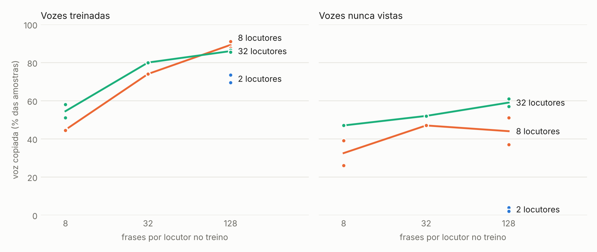

# Tacotron2-VAE — síntese de fala em português com estilo copiado de um áudio de referência

**Projeto final de ML2 (IMPA Tech)** · [Página do projeto](https://rick0110.github.io/ml2_final_project) · [Relatório (PDF)](reports/relatorio_final.pdf) · [Proposta de pesquisa (PDF)](reports/proposta/proposta.pdf)

> **Pesquisa em andamento:** a organização da pesquisa (pergunta, resultados um a um e caminhos em exploração) está em [`research/`](research/README.md). Para trabalhar no projeto, leia antes o [`AGENTS.md`](AGENTS.md).

Sistema de síntese de fala (*Text-to-Speech*) baseado no **Tacotron 2** com um **VAE** que resume um áudio de referência em um vetor de estilo. O texto diz *o que* falar; o áudio de referência diz *como* (tom, velocidade, voz, emoção).

> **Revisão de novembro de 2026.** A versão anterior deste projeto descrevia uma "atenção espectral interpretável". Esse resultado **não era válido**: vinha de um erro de código (seção 2). O código foi corrigido, os modelos foram retreinados e todos os áudios passaram a ser conferidos por reconhecimento de fala. Este README, o relatório e a página descrevem só os resultados novos.

## 1. Resultados

Cada áudio gerado é transcrito pelo Whisper e comparado com o texto pedido. A medida é a taxa de palavras erradas (WER): 0% significa que tudo foi entendido.

| Modelo | Dados de treino | Palavras erradas | Termina a frase sozinho |
|---|---|---|---|
| Inglês, versão antiga | LJSpeech | 68% (26 áudios) | nem sempre |
| Português, versão antiga | VERBO (98 falas) | 100% (ininteligível) | — |
| **Inglês, retreinado** | LJSpeech, 2.500 passos | **2,2%** (18 áudios) | 100% |
| **Português, retreinado** | TTS-Portuguese Corpus, 4.000 passos | **10,5%** (18 áudios) | 100% |
| Emoção: português → só VERBO | VERBO, 1.500 passos | 52% (60 áudios) | 100% |
| Emoção: português + VERBO | os dois juntos, 1.500 passos | 41% (60 áudios) | 100% |
| **Emoção: português + VERBO, estilo a 60%** | idem | **9%** (42 áudios) | 100% |

O que os números mostram:

- **Inteligibilidade.** Partir do Tacotron 2 pré-treinado da NVIDIA, em vez de treinar do zero, resolveu o problema principal. O português foi obtido ajustando o modelo em inglês em 3,8 h de fala.
- **Velocidade copiada da referência (português).** Com referências lenta, média e rápida (9, 13 e 16 caracteres por segundo), a fala gerada saiu com cerca de 9, 12 e 13.
- **Voz e tom copiados (VERBO).** Com referências de emoção, o tom médio da fala gerada acompanha o da referência (correlação 0,97 em 10 referências), inclusive trocando voz feminina por masculina.
- **Emoção forte custa inteligibilidade.** O VERBO tem só 14 frases: com o estilo inteiro da referência o modelo fala com uma voz que quase não conhece, e erra 41% das palavras. Multiplicando o código de estilo por 0,6 (`--style-strength` no `synth_check.py`), o erro cai para 9%; sobra da emoção principalmente o ritmo.
- **No inglês o estilo quase não muda.** O LJSpeech é uma locutora lendo sempre do mesmo jeito; há pouca variação para o VAE aprender.

Limitações conhecidas: sobram trocas de palavras no português ("carrega" → "cariga"); a avaliação usa 6 frases por referência, uma amostra pequena; a naturalidade não foi medida por ouvintes, só a inteligibilidade por reconhecimento automático.

Áudios e figuras: [rick0110.github.io/ml2_final_project](https://rick0110.github.io/ml2_final_project).

## 2. O que estava errado e foi corrigido

| Problema | Efeito | Correção |
|---|---|---|
| O *reference encoder* reorganizava o mel `(B, 80, T)` com `.view(B, 1, -1, 80)` sem transpor os eixos | Tempo e frequência ficavam misturados, e o resultado mudava com o *padding* do lote. As "bandas do espectro" da atenção eram consequência disso | `transpose(1, 2)` antes das convoluções (`src/models/tacotron2_vae/modules.py`). A GRU percorre blocos de **tempo** de ~0,74 s |
| O resumo da referência incluía os blocos de *padding* | O vetor de estilo de uma mesma fala mudava com o tamanho do lote | A atenção dá peso zero ao *padding* |
| Uma `LayerNorm` extra na atenção do decoder, que não existe no Tacotron 2 | Os pesos pré-treinados não funcionavam: a síntese nunca chegava ao fim da frase | Removida |
| Treino do zero, com poucos dados | Alinhamento texto–áudio ruim; no VERBO (5 min), fala ininteligível | Treino a partir do Tacotron 2 pré-treinado, em etapas: inglês → português → emoção |
| Ajuste só no VERBO (14 frases) | O modelo aprende as emoções mas desaprende a ler texto novo (52% de erro) | Treino com o corpus de português e o VERBO juntos, e controle de intensidade do estilo |
| Vocoder WaveGlow treinado só em voz inglesa | Artefatos em outras vozes | HiFi-GAN universal pré-treinado (`src/models/hifigan.py`) |
| Comparação com o *baseline* com treinos de tamanhos diferentes (11,2 mil vs. 35,5 mil iterações) | A conclusão "a atenção evita o colapso do latente" não se sustentava | Comparação retirada |

O *pooling* por atenção sobre os blocos de tempo foi mantido, agora correto. Não refizemos a comparação com o *baseline* (último estado da GRU), então **não afirmamos** que ele é melhor.

## 3. Arquitetura

```
Texto ──► Encoder (embedding + 3×Conv1d + BiLSTM) ──►(+)──► Atenção ──► Decoder ──► Postnet ──► HiFi-GAN ──► áudio
                                                      ▲    location-    autoregressivo
Mel de referência ──► Reference encoder (VAE) ──► e ──┘    sensitive    + gate de parada
                      6×Conv2d (1ª CoordConv) + GRU
                      + pooling por atenção → μ, σ → z
```

- **Encoder de texto:** embedding de símbolos → 3 convoluções 1D → BiLSTM. Inglês usa caracteres; português usa fonemas IPA (`gruut`). Os dois conjuntos convivem na mesma tabela de 199 símbolos, o que permite ajustar o modelo em inglês para o português.
- **Reference encoder:** 6 convoluções 2D de *stride* 2 reduzem o mel 80×T; uma GRU percorre T/64 blocos de tempo; um *pooling* por atenção resume os estados; o resultado vira (μ, log σ²), de onde se amostra `z` (32 dimensões). `z` é convertido no vetor de estilo `e`, somado a todas as posições da saída do encoder de texto.
- **Decoder:** atenção *location-sensitive*, prenet, 2 LSTMs, projeção para o quadro mel e para o sinal de parada; postnet de 5 convoluções.
- **Vocoder:** HiFi-GAN UNIVERSAL_V1 pré-treinado, congelado.

## 4. Perdas de treinamento

```
L = L_mel + L_gate + β(passo)·L_KL + λ·L_GA
```

| Perda | Descrição |
|---|---|
| `L_mel` | Erro quadrático do mel (decoder + postnet), mascarado no *padding* |
| `L_gate` | Entropia cruzada do sinal de parada |
| `L_KL` | Divergência KL com *free bits* de 0,5 nats por dimensão |
| `β(passo)` | *Annealing* cíclico: rampa de 0 a 0,2 em 4.000 passos, após 2.000 de espera |
| `L_GA` | Atenção guiada (Tachibana et al. 2017): penaliza atenção longe da diagonal |

## 5. Dados

| Corpus | Falas usadas | Duração | Papel |
|---|---|---|---|
| LJSpeech 1.1 | 13.100 | 23,7 h | Inglês, uma locutora |
| TTS-Portuguese Corpus | 2.245 (até 11 s) | 3,8 h | Português, um locutor |
| VERBO | 1.167 | minutos | Português, 12 locutores, 7 emoções, 14 frases |

Áudio: 22.050 Hz, 80 canais mel, FFT 1024, *hop* 256, f_max 8 kHz.

## 6. Como reproduzir

```bash
# 1. Manifesto do corpus (áudio reamostrado + CSV)
python scripts/preprocess/make_manifest.py --corpus ljspeech \
  --input-dir data/raw/LJSpeech-1.1 --out-dir data/processed/LJSpeech

# 2. Treino em inglês a partir do Tacotron 2 pré-treinado da NVIDIA
python src/training/training-tacotron2-vae/train.py \
  --artifacts-dir data/processed/LJSpeech --text-cleaner english_cleaners \
  --pretrained-tacotron2 ckpt/tacotron2_nvidia.pt \
  --batch-size 48 --learning-rate 1e-4 --warmup-steps 500 --max-steps 2500 \
  --guided-attention-weight 2.0 --guided-attention-sigma 0.4 \
  --experiment-name en_vae_v1

# 3. Conferência por reconhecimento de fala (gera .wav, figuras e results.csv)
python scripts/eval/synth_check.py --checkpoint experiments/tacotron2-vae/en_vae_v1/checkpoints/epoch_2500 \
  --hifigan ckpt/hifigan_universal_v1.pt --data-dir data/processed/LJSpeech \
  --text-cleaner english_cleaners --language en --out-dir exports/eval/en_vae_v1
```

As etapas seguintes trocam o corpus e partem do modelo anterior com `--checkpoint-path`. A receita completa de cada etapa (downloads, parâmetros) está em `scripts/cloud/stage_setup.sh` e `scripts/cloud/train_job.sh`, que foram os scripts usados no Google Cloud (uma GPU L4 *spot*).

O treino grava `metrics.jsonl` e figuras em `experiments/tacotron2-vae/<experimento>/`: perdas, dimensões ativas do latente, nitidez do alinhamento na síntese livre e normas de gradiente por módulo. Também há logs para o TensorBoard em `logs/`.

## 7. Estrutura do repositório

```text
ml2_final_project/
├── src/
│   ├── data/loader_vae_tacotron/      # Dataset e DataLoader (calcula e guarda o mel)
│   ├── models/tacotron2_vae/          # Encoder, decoder, atenção, VAE, hparams
│   ├── models/hifigan.py              # Vocoder (pré-treinado, congelado)
│   └── training/training-tacotron2-vae/  # train.py, perdas, laço de treino, métricas
├── scripts/
│   ├── preprocess/make_manifest.py    # Manifesto de LJSpeech, TTS-Portuguese e VERBO
│   ├── preprocess/cache_mels.py       # Pré-calcula os mels em paralelo
│   ├── eval/synth_check.py            # Síntese + conferência por reconhecimento de fala
│   ├── cloud/                         # Jobs de treino e avaliação no Google Cloud
│   └── site_assets/make_figures.py    # Figuras do relatório e da página
├── docs/                              # Página do projeto (GitHub Pages)
├── reports/                           # Relatório (LaTeX + PDF)
└── notebooks/                         # Notebooks da versão anterior (ver aviso abaixo)
```

Os notebooks de análise da atenção (`attention_analysis`, `attention_deep_analysis`, `style_transfer_demo`) e os scripts antigos em `scripts/site_assets/` (`generate_assets.py`, `plot_all.py`) foram escritos para a versão com o erro e não foram refeitos.

## 8. Instalação

```bash
git clone https://github.com/rick0110/ml2_final_project.git
cd ml2_final_project
python -m venv .venv && source .venv/bin/activate
pip install -r requirements.txt
```

Requisitos: Python 3.10+, GPU CUDA para treino. Modelos pré-treinados usados: [Tacotron 2 da NVIDIA](https://catalog.ngc.nvidia.com/orgs/nvidia/models/tacotron2_pyt_ckpt_amp) e [HiFi-GAN UNIVERSAL_V1](https://github.com/jik876/hifi-gan).

## 9. Experimento: quanta cobertura de dados o estilo precisa

Pergunta: quando um estilo (aqui, uma voz) aparece no treino com poucas frases, o modelo consegue falar um texto novo com ele? E como isso muda com o número de estilos e com o número de frases por estilo?

Montagem: 2.000 frases do LJSpeech (a voz padrão, com muito texto) mais N locutores do LibriTTS com K frases cada, partindo do modelo em inglês, 2.500 passos por treino. Em cada treino sintetizamos 25 frases fora do treino com 8 referências de vozes treinadas e 4 de vozes nunca vistas. "Voz copiada" é a parcela das amostras cujo áudio fica mais parecido com a referência do que com a voz padrão, segundo um codificador de locutor externo (Resemblyzer). Onde há dois números, são duas sementes.

| Locutores (N) | Frases por locutor (K) | Palavras erradas: treinadas | Palavras erradas: novas | Voz copiada: treinadas | Voz copiada: novas |
|---|---|---|---|---|---|
| 2 | 128 | 13% / 11% | 8% / 5% | 70% / 74% | 4% / 2% |
| 8 | 8 | 21% / 26% | 14% / 24% | 45% / 44% | 26% / 39% |
| 8 | 32 | 17% | 14% | 74% | 47% |
| 8 | 128 | 11% / 10% | 8% / 9% | 91% / 88% | 51% / 37% |
| 32 | 8 | 17% / 17% | 13% / 9% | 58% / 51% | 47% / 47% |
| 32 | 32 | 13% | 8% | 80% | 52% |
| 32 | 128 | 12% / 10% | 5% / 5% | 86% / 86% | 61% / 57% |



O que os números mostram:

- **Frases por locutor decidem as vozes treinadas.** Com 8 locutores, a cópia da voz vai de 45% (8 frases) a 74% (32) e 90% (128).
- **Número de locutores decide as vozes novas.** Com 128 frases por locutor, a cópia de vozes nunca vistas vai de 3% (2 locutores) a 44% (8) e 59% (32).
- **Muitos locutores compensam poucas frases.** 32 locutores com 8 frases (256 frases) copiam vozes novas tanto quanto 8 locutores com 128 (1.024 frases).
- **O latente explica o erro.** Em 144 referências, quanto mais longe da voz padrão está o código de estilo, mais a voz é copiada (correlação de postos 0,83) e mais palavras saem erradas (0,45). Cerca de 80% da variância do latente é diferença entre locutores.
- **Estilo a 60%** reduz o erro de palavras para 4–9% em todos os treinos, mas a cópia da voz cai junto; só o treino 32 × 128 ainda copia cerca de 45% das vozes novas.

**Duas perdas que não ajudaram (resultado negativo).** Para testar se o problema é o código de estilo carregar o conteúdo da frase, três treinos foram repetidos de duas formas: tirando o estilo de outra frase do mesmo locutor (`--swap-reference`) e, além disso, com uma perda contrastiva que aproxima os códigos de duas frases do mesmo locutor e afasta os de locutores diferentes (`--contrastive-weight 0.5`). Em 2.500 passos, com estilo na força 1,0, nada mudou além da variação entre sementes:

| N × K | Variante | WER treinadas | WER novas | Voz copiada treinadas | Voz copiada novas |
|---|---|---|---|---|---|
| 8 × 8 | normal | 21% / 26% | 14% / 24% | 45% / 44% | 26% / 39% |
| 8 × 8 | troca | 23% / 25% | 21% / 24% | 52% / 48% | 27% / 32% |
| 8 × 8 | troca + contrastiva | 27% / 23% | 20% / 21% | 42% / 48% | 27% / 31% |
| 8 × 128 | normal (semente 1) | 11% | 8% | 91% | 51% |
| 8 × 128 | troca (semente 1) | 12% | 8% | 87% | 38% |
| 8 × 128 | troca + contrastiva (semente 1) | 14% | 10% | 85% | 39% |

Com estilo a 60% a contrastiva muda o compromisso, sem melhorá-lo: no 8 × 128 as vozes treinadas copiadas sobem de 48% para 70% e as novas de 22% para 29%, mas o WER sobe de 5–7% para 7–9%; no 8 × 8 a cópia sai de 0% para 11–20% e o WER de 5–9% para 13–15%. Ou seja, impedir o latente de carregar a frase não reduz a quantidade de dados necessária; o gargalo parece estar em quantas vozes e frases o decodificador viu. O peso e a temperatura da contrastiva não foram ajustados.

**Vetor de locutor pré-treinado: ignorado pelo treino (resultado negativo).** Três treinos (8 × 8, 8 × 128, 2 × 128) receberam uma segunda entrada de estilo: o vetor de um codificador de locutor congelado (ECAPA-TDNN, `--speaker-embeddings`), somado ao texto codificado ao lado do vetor do VAE. Em 2.500 passos o modelo não usa essa entrada: com o VAE zerado (força 0,0) e só o vetor de locutor, nenhuma voz é copiada (0% nos três treinos) e a fala sai na voz padrão. Com o VAE ligado, os números ficam iguais aos dos treinos normais:

| N × K (semente 1) | Variante | WER treinadas | WER novas | Voz copiada treinadas | Voz copiada novas |
|---|---|---|---|---|---|
| 8 × 8 | normal | 21% | 14% | 45% | 26% |
| 8 × 8 | com vetor de locutor | 18% | 14% | 43% | 30% |
| 8 × 128 | normal | 11% | 8% | 91% | 51% |
| 8 × 128 | com vetor de locutor | 13% | 8% | 88% | 46% |
| 2 × 128 | normal | 13% | 8% | 70% | 4% |
| 2 × 128 | com vetor de locutor | 14% | 8% | 70% | 4% |

A leitura provável: o VAE vê o áudio alvo e já entrega a voz, então o treino não tem motivo para usar a entrada nova.

**Dropout de estilo: o vetor passa a ser usado, mas não reduz a necessidade de locutores.** Zerando o vetor do VAE em metade dos itens de treino (`--style-dropout 0.5`), a voz tem de passar pelo vetor de locutor. Três treinos, uma semente, 2.500 passos; "só vetor" é a força 0,0 (VAE zerado), "vetor + VAE" é a força 1,0:

| N × K | Variante | WER treinadas | WER novas | Voz copiada treinadas | Voz copiada novas |
|---|---|---|---|---|---|
| 8 × 128 | normal | 11% | 8% | 91% | 51% |
| 8 × 128 | dropout, só vetor | 9% | 6% | 71% | 5% |
| 8 × 128 | dropout, vetor + VAE | 14% | 8% | 88% | 37% |
| 32 × 8 | normal (2 sementes) | 17% / 17% | 13% / 9% | 58% / 51% | 47% / 47% |
| 32 × 8 | dropout, só vetor | 11% | 7% | 9% | 1% |
| 32 × 8 | dropout, vetor + VAE | 22% | 15% | 57% | 60% |
| 32 × 128 | normal (2 sementes) | 12% / 10% | 5% / 5% | 86% / 86% | 61% / 57% |
| 32 × 128 | dropout, só vetor | 9% | 6% | 64% | 47% |
| 32 × 128 | dropout, vetor + VAE | 12% | 6% | 83% | 62% |

Com 8 locutores, o vetor sozinho copia as vozes treinadas (71%) e quase nenhuma nova (5%): a projeção decora os locutores do treino. Com 32 locutores e 128 frases ele já copia 47% das vozes novas sozinho, mas o conjunto vetor + VAE fica igual ao treino normal (62% contra 61% / 57%). Com 8 frases por locutor o vetor quase não é aprendido. Ou seja, um codificador de locutor treinado em milhares de vozes não dispensa o decodificador de ver muitos locutores: o que limita a cópia de vozes novas é quantas vozes o decodificador ouviu, seja qual for o caminho por onde a voz chega. As diferenças de até 13 pontos em vozes novas (32 × 8) estão dentro da variação entre sementes.

**Tratativa teórica e teste da solução derivada (negativo).** [`reports/teoria_cobertura.md`](reports/teoria_cobertura.md) organiza estes resultados numa lei de amostragem em dois níveis (vozes novas não copiadas ≈ a + A/N + B/(N·K); treinadas ≈ a' + C/K + A'/N), que ajusta os 12 treinos até o nível do ruído entre sementes (`scripts/coverage/fit_law.py`) e explica por que as quatro mudanças acima não ajudaram: nenhuma acrescenta vozes ao treino do decodificador. A solução derivada foi criar pseudo-locutores alterando a velocidade das gravações (`scripts/coverage/augment_voices.py`, variante `-aug`), com as previsões registradas antes do resultado. Ela não funcionou: as pseudo-vozes não contam como locutores.

| Treino (passo 2.500, estilo inteiro) | Vozes treinadas copiadas | Vozes novas copiadas | WER vozes novas |
|---|---|---|---|
| 8 × 8 normal (2 sementes) | 45% / 44% | 26% / 39% | 14% / 24% |
| 8 × 8 com pseudo-locutores | 50% | 28% (previsto ~31% se não contam, ~50% se contam) | 14% |
| 8 × 128 normal (2 sementes) | 91% / 88% | 51% / 37% | 8% / 9% |
| 8 × 128 com pseudo-locutores | 84% | 42% (previsto ~44% / ~55%) | 8% |

A lei previu os dois números com N = 8 locutores reais. O que conta é a variedade real de vozes; os caminhos que sobram são separar a leitura do texto da troca de voz (conversão de voz treinada sem transcrição em muitos locutores) e usar várias referências por voz.

**128 locutores e várias referências por voz.** Previsões registradas antes (seção 8 da nota teórica). Com 128 locutores × 8 frases a lei acertou (55% das vozes novas copiadas, previsto 56%; treinadas 52%, previsto 52%). Com 128 × 32 ela errou para cima: 74% das vozes novas copiadas com 8% de WER (previsto 57%), o melhor resultado do projeto. Uma réplica com outra semente deu 56% (média das duas: 65%), e um treino com 200 locutores deu 64%: os 74% eram em boa parte sorte da semente, e de 128 para 200 locutores não há ganho mensurável. As duas leis candidatas (queda em 1/N ou em 1/√N) ajustam os 16 treinos igualmente bem; o ruído entre sementes (até 18 pontos, com 4 vozes novas por avaliação) é maior que a diferença entre elas. Usar a média do código de estilo de 4 ou 16 frases do mesmo locutor (`--n-refs` em `scripts/eval/synth_check.py`) sobe a cópia das vozes novas de 47% para 67% no treino 128 × 8 e, com 4 frases, sobe também nos outros três treinos (128 × 32: 74% → 78% e 59% → 69%; 200 × 32: 57% → 75%), enquanto a das vozes treinadas cai até 13 pontos; o WER das vozes de outro corpus cai de 16% para 9%. As referências passam a incluir 4 locutores do LibriTTS test-clean ("externos"). Os scripts de conversão de voz (`vc_cascade.py`, `vc_voices.py`) estão prontos mas não foram executados.

| Treino (passo 2.500) | Treinadas copiadas | Novas copiadas | Externas copiadas | WER novas |
|---|---|---|---|---|
| 128 × 8 | 52% | 55% | 86% | 8% |
| 128 × 32 (2 sementes) | 76% / 66% | 74% / 56% | 86% / 86% | 8% / 8% |
| 200 × 32 | 66% | 64% | 91% | 7% |

**Avaliação em 38 vozes nunca ouvidas.** Como 4 vozes novas dão uma medida ruidosa, três treinos com 32 frases por locutor foram avaliados em 38 locutores do LibriTTS test-clean (950 amostras cada; intervalos por reamostragem dos locutores). Previsões na seção 8.7 da nota teórica, resultado na 8.8:

| Treino | Externas copiadas (IC 95%) | WER externas |
|---|---|---|
| 8 × 32 | 57% (43–70) | 13% |
| 32 × 32 | 70% (58–81) | 12% |
| 128 × 32 | 79% (68–89) | 12% |

O ganho de 32 para 128 locutores é de 9 pontos (IC 95% de 1,5 a 17), quase tanto quanto de 8 para 32 (13 pontos), sem piorar o WER, o que desfaz a impressão, vinda das 4 vozes, de que acima de 128 locutores não há ganho. A forma da curva não está estabelecida: uma revisão estatística (seção 8.10 da nota teórica, [`reports/teoria/04_dados.md`](reports/teoria/04_dados.md)) mostra que três pontos de uma semente não distinguem as leis candidatas nem fixam o expoente, e que parte da dificuldade das vozes vem da própria medida, que compara com a voz padrão. Nessa avaliação a média de 4 referências não melhora a cópia (cai 2 a 4 pontos) e só reduz o WER em 1 a 3 pontos; o ganho que ela mostrava era das 4 vozes da grade.

Limites: duas configurações têm uma semente só; cada treino usa 4 vozes novas e 8 treinadas; entre sementes, a cópia de vozes novas varia até 18 pontos; a medida de voz copiada depende de um único codificador de locutor.

Reprodução: `scripts/coverage/colab_job.sh` (treino e avaliação), `scripts/coverage/summarize.py` (tabela e figura). Resultados por amostra em `reports/coverage/results/`.

**Teoria da informação: o gargalo é o decodificador.** Medindo nos áudios gerados quanta informação sobre a voz da referência atravessa o sistema (identificação entre as 38 vozes externas; teto de 5,25 bits), a referência e o latente carregam 4 a 5 bits, mas a saída só 0,3 bit com 8 locutores e cerca de 1 bit com 128 (cota de Fano). O ganho com mais locutores vem de o decodificador alcançar mais vozes diferentes, com o mesmo ruído por voz, à razão de cerca de 0,3 bit por duplicação. Detalhes na seção 8.11 da [nota teórica](reports/teoria_cobertura.md) e na seção 8 da [proposta](reports/proposta/proposta.pdf).

**Experimentos prontos para a próxima GPU.** Variantes novas em `scripts/coverage/colab_job.sh`: `-film` (estilo modulando cada passo do decodificador), `-z8` / `-z2` (latente menor) e `-lj1000` (metade das frases da voz padrão). Cada avaliação calcula também os bits de voz que chegam à saída (`scripts/coverage/voice_bits.py`). Previsões registradas na seção 8.12 da nota teórica.

## 10. Próximo passo: dublagem

O objetivo seguinte é dublar filmes: texto traduzido + áudio do ator original como referência de estilo. O que este projeto já entrega para isso é a síntese em português com tom e velocidade vindos de uma referência. O que falta: controlar a duração de cada fala para caber na cena, usar o vídeo (movimento da boca) como entrada, e sincronia labial.

## Créditos

**Discentes:** Beatriz Nunes, Herivelton Siqueira, Richard Viana · **Professores:** Francisco Ganacim, Daniel Silveira Yukimura Lopez · **IMPA Tech**.

**Referências principais:** Zhang et al. 2019 (VAE-TTS) · Hsu et al. 2019 · Shen et al. 2018 (Tacotron 2) · Skerry-Ryan et al. 2018 (*reference encoder*) · Kong et al. 2020 (HiFi-GAN) · Tachibana et al. 2017 (atenção guiada) · Casanova et al. 2022 (TTS-Portuguese Corpus) · Torres Neto et al. 2018 (VERBO) · Radford et al. 2023 (Whisper).
