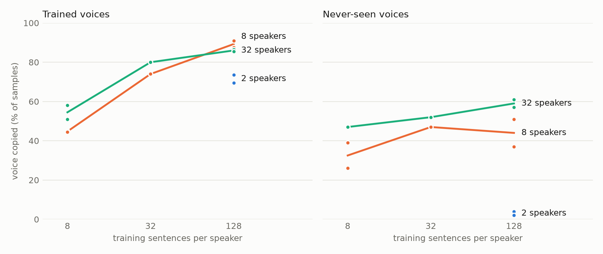

# Tacotron2-VAE — Portuguese speech synthesis with the style copied from a reference audio clip

**ML2 final project (IMPA Tech)** · [Project page](https://rick0110.github.io/ml2_final_project) · [Report (PDF)](reports/final_report.pdf) · [Research proposal (PDF)](reports/proposal/proposal.pdf)

> **Research in progress:** the organization of the research (question, results one by one, and paths under exploration) is in [`research/`](research/README.md). To work on the project, read [`AGENTS.md`](AGENTS.md) first.

A speech synthesis (*Text-to-Speech*) system based on **Tacotron 2** with a **VAE** that summarizes a reference audio clip into a style vector. The text says *what* to say; the reference audio says *how* (pitch, speed, voice, emotion).

> **November 2026 revision.** The previous version of this project described an "interpretable spectral attention". That result **was not valid**: it came from a code bug (section 2). The code was fixed, the models were retrained, and every audio clip is now checked with speech recognition. This README, the report and the page describe only the new results.

## 1. Results

Each generated audio clip is transcribed by Whisper and compared with the requested text. The measure is the word error rate (WER): 0% means everything was understood.

| Model | Training data | Wrong words | Finishes the sentence on its own |
|---|---|---|---|
| English, old version | LJSpeech | 68% (26 clips) | not always |
| Portuguese, old version | VERBO (98 utterances) | 100% (unintelligible) | — |
| **English, retrained** | LJSpeech, 2,500 steps | **2.2%** (18 clips) | 100% |
| **Portuguese, retrained** | TTS-Portuguese Corpus, 4,000 steps | **10.5%** (18 clips) | 100% |
| Emotion: Portuguese → VERBO only | VERBO, 1,500 steps | 52% (60 clips) | 100% |
| Emotion: Portuguese + VERBO | both together, 1,500 steps | 41% (60 clips) | 100% |
| **Emotion: Portuguese + VERBO, style at 60%** | same | **9%** (42 clips) | 100% |

What the numbers show:

- **Intelligibility.** Starting from NVIDIA's pretrained Tacotron 2, instead of training from scratch, solved the main problem. Portuguese was obtained by fine-tuning the English model on 3.8 h of speech.
- **Speed copied from the reference (Portuguese).** With slow, medium and fast references (9, 13 and 16 characters per second), the generated speech came out at about 9, 12 and 13.
- **Voice and pitch copied (VERBO).** With emotion references, the mean pitch of the generated speech follows that of the reference (correlation 0.97 over 10 references), including switching from a female to a male voice.
- **Strong emotion costs intelligibility.** VERBO has only 14 sentences: with the full style of the reference, the model speaks in a voice it barely knows and gets 41% of the words wrong. Multiplying the style code by 0.6 (`--style-strength` in `synth_check.py`), the error drops to 9%; what remains of the emotion is mainly the rhythm.
- **In English the style barely changes.** LJSpeech is a single female speaker always reading the same way; there is little variation for the VAE to learn.

Known limitations: some word substitutions remain in Portuguese ("carrega" → "cariga"); the evaluation uses 6 sentences per reference, a small sample; naturalness was not measured by listeners, only intelligibility by automatic recognition.

Audio and figures: [rick0110.github.io/ml2_final_project](https://rick0110.github.io/ml2_final_project).

## 2. What was wrong and was fixed

| Problem | Effect | Fix |
|---|---|---|
| The *reference encoder* reshaped the mel `(B, 80, T)` with `.view(B, 1, -1, 80)` without transposing the axes | Time and frequency were mixed, and the result changed with the batch *padding*. The attention's "spectral bands" were a consequence of this | `transpose(1, 2)` before the convolutions (`src/models/tacotron2_vae/modules.py`). The GRU runs over **time** blocks of ~0.74 s |
| The reference summary included the *padding* blocks | The style vector of the same utterance changed with the batch size | The attention gives zero weight to the *padding* |
| An extra `LayerNorm` in the decoder attention, which does not exist in Tacotron 2 | The pretrained weights did not work: synthesis never reached the end of the sentence | Removed |
| Training from scratch, with little data | Poor text–audio alignment; on VERBO (5 min), unintelligible speech | Training from the pretrained Tacotron 2, in stages: English → Portuguese → emotion |
| Fine-tuning on VERBO only (14 sentences) | The model learns the emotions but unlearns how to read new text (52% error) | Training on the Portuguese corpus and VERBO together, plus a style strength control |
| WaveGlow vocoder trained only on English speech | Artifacts on other voices | Pretrained universal HiFi-GAN (`src/models/hifigan.py`) |
| Comparison with the *baseline* using trainings of different lengths (11.2 thousand vs. 35.5 thousand iterations) | The conclusion "the attention prevents latent collapse" did not hold | Comparison removed |

The attention *pooling* over the time blocks was kept, now correct. We did not redo the comparison with the *baseline* (last GRU state), so we **do not claim** that it is better.

## 3. Architecture

```
Text  ──► Encoder (embedding + 3×Conv1d + BiLSTM) ──►(+)──► Attention ──► Decoder ──► Postnet ──► HiFi-GAN ──► audio
                                                      ▲    location-      autoregressive
Reference mel ──────► Reference encoder (VAE) ──► e ──┘    sensitive      + stop gate
                      6×Conv2d (1st CoordConv) + GRU
                      + attention pooling → μ, σ → z
```

- **Text encoder:** symbol embedding → 3 1D convolutions → BiLSTM. English uses characters; Portuguese uses IPA phonemes (`gruut`). The two sets live in the same table of 199 symbols, which makes it possible to fine-tune the English model for Portuguese.
- **Reference encoder:** 6 2D convolutions with *stride* 2 reduce the 80×T mel; a GRU runs over T/64 time blocks; an attention *pooling* summarizes the states; the result becomes (μ, log σ²), from which `z` (32 dimensions) is sampled. `z` is converted into the style vector `e`, added to every position of the text encoder output.
- **Decoder:** *location-sensitive* attention, prenet, 2 LSTMs, projection to the mel frame and to the stop signal; postnet of 5 convolutions.
- **Vocoder:** pretrained HiFi-GAN UNIVERSAL_V1, frozen.

## 4. Training losses

```
L = L_mel + L_gate + β(step)·L_KL + λ·L_GA
```

| Loss | Description |
|---|---|
| `L_mel` | Mean squared error of the mel (decoder + postnet), masked on the *padding* |
| `L_gate` | Cross-entropy of the stop signal |
| `L_KL` | KL divergence with *free bits* of 0.5 nats per dimension |
| `β(step)` | Cyclical *annealing*: ramp from 0 to 0.2 over 4,000 steps, after a 2,000-step wait |
| `L_GA` | Guided attention (Tachibana et al. 2017): penalizes attention far from the diagonal |

## 5. Data

| Corpus | Utterances used | Duration | Role |
|---|---|---|---|
| LJSpeech 1.1 | 13,100 | 23.7 h | English, one female speaker |
| TTS-Portuguese Corpus | 2,245 (up to 11 s) | 3.8 h | Portuguese, one male speaker |
| VERBO | 1,167 | minutes | Portuguese, 12 speakers, 7 emotions, 14 sentences |

Audio: 22,050 Hz, 80 mel channels, FFT 1024, *hop* 256, f_max 8 kHz.

## 6. How to reproduce

```bash
# 1. Corpus manifest (resampled audio + CSV)
python scripts/preprocess/make_manifest.py --corpus ljspeech \
  --input-dir data/raw/LJSpeech-1.1 --out-dir data/processed/LJSpeech

# 2. English training starting from NVIDIA's pretrained Tacotron 2
python src/training/training-tacotron2-vae/train.py \
  --artifacts-dir data/processed/LJSpeech --text-cleaner english_cleaners \
  --pretrained-tacotron2 ckpt/tacotron2_nvidia.pt \
  --batch-size 48 --learning-rate 1e-4 --warmup-steps 500 --max-steps 2500 \
  --guided-attention-weight 2.0 --guided-attention-sigma 0.4 \
  --experiment-name en_vae_v1

# 3. Check with speech recognition (generates .wav files, figures and results.csv)
python scripts/eval/synth_check.py --checkpoint experiments/tacotron2-vae/en_vae_v1/checkpoints/epoch_2500 \
  --hifigan ckpt/hifigan_universal_v1.pt --data-dir data/processed/LJSpeech \
  --text-cleaner english_cleaners --language en --out-dir exports/eval/en_vae_v1
```

The following stages switch the corpus and start from the previous model with `--checkpoint-path`. The full recipe for each stage (downloads, parameters) is in `scripts/cloud/stage_setup.sh` and `scripts/cloud/train_job.sh`, which were the scripts used on Google Cloud (one L4 *spot* GPU).

Training writes `metrics.jsonl` and figures to `experiments/tacotron2-vae/<experiment>/`: losses, active latent dimensions, alignment sharpness in free-running synthesis, and gradient norms per module. There are also TensorBoard logs in `logs/`.

## 7. Repository structure

```text
ml2_final_project/
├── src/
│   ├── data/loader_vae_tacotron/      # Dataset and DataLoader (computes and stores the mel)
│   ├── models/tacotron2_vae/          # Encoder, decoder, attention, VAE, hparams
│   ├── models/hifigan.py              # Vocoder (pretrained, frozen)
│   └── training/training-tacotron2-vae/  # train.py, losses, training loop, metrics
├── scripts/
│   ├── preprocess/make_manifest.py    # Manifest for LJSpeech, TTS-Portuguese and VERBO
│   ├── preprocess/cache_mels.py       # Precomputes the mels in parallel
│   ├── eval/synth_check.py            # Synthesis + check with speech recognition
│   ├── cloud/                         # Training and evaluation jobs on Google Cloud
│   └── site_assets/make_figures.py    # Figures for the report and the page
├── docs/                              # Project page (GitHub Pages)
├── reports/                           # Report (LaTeX + PDF)
└── notebooks/                         # Notebooks from the previous version (see note below)
```

The attention analysis notebooks (`attention_analysis`, `attention_deep_analysis`, `style_transfer_demo`) and the old scripts in `scripts/site_assets/` (`generate_assets.py`, `plot_all.py`) were written for the version with the bug and have not been redone.

## 8. Installation

```bash
git clone https://github.com/rick0110/ml2_final_project.git
cd ml2_final_project
python -m venv .venv && source .venv/bin/activate
pip install -r requirements.txt
```

Requirements: Python 3.10+, a CUDA GPU for training. Pretrained models used: [NVIDIA's Tacotron 2](https://catalog.ngc.nvidia.com/orgs/nvidia/models/tacotron2_pyt_ckpt_amp) and [HiFi-GAN UNIVERSAL_V1](https://github.com/jik876/hifi-gan).

## 9. Experiment: how much data coverage the style needs

Question: when a style (here, a voice) appears in training with only a few sentences, can the model speak new text with it? And how does this change with the number of styles and the number of sentences per style?

Setup: 2,000 LJSpeech sentences (the default voice, with plenty of text) plus N LibriTTS speakers with K sentences each, starting from the English model, 2,500 steps per training run. In each run we synthesize 25 held-out sentences with 8 references from trained voices and 4 from never-seen voices. "Voice copied" is the share of samples whose audio is closer to the reference than to the default voice, according to an external speaker encoder (Resemblyzer). Where there are two numbers, they are two seeds.

| Speakers (N) | Sentences per speaker (K) | Wrong words: trained | Wrong words: new | Voice copied: trained | Voice copied: new |
|---|---|---|---|---|---|
| 2 | 128 | 13% / 11% | 8% / 5% | 70% / 74% | 4% / 2% |
| 8 | 8 | 21% / 26% | 14% / 24% | 45% / 44% | 26% / 39% |
| 8 | 32 | 17% | 14% | 74% | 47% |
| 8 | 128 | 11% / 10% | 8% / 9% | 91% / 88% | 51% / 37% |
| 32 | 8 | 17% / 17% | 13% / 9% | 58% / 51% | 47% / 47% |
| 32 | 32 | 13% | 8% | 80% | 52% |
| 32 | 128 | 12% / 10% | 5% / 5% | 86% / 86% | 61% / 57% |



What the numbers show:

- **Sentences per speaker decide the trained voices.** With 8 speakers, voice copying goes from 45% (8 sentences) to 74% (32) and 90% (128).
- **The number of speakers decides the new voices.** With 128 sentences per speaker, copying of never-seen voices goes from 3% (2 speakers) to 44% (8) and 59% (32).
- **Many speakers make up for few sentences.** 32 speakers with 8 sentences (256 sentences) copy new voices as well as 8 speakers with 128 (1,024 sentences).
- **The latent explains the error.** Over 144 references, the farther the style code is from the default voice, the more the voice is copied (rank correlation 0.83) and the more words come out wrong (0.45). About 80% of the latent variance is difference between speakers.
- **Style at 60%** reduces the word error to 4–9% in all runs, but voice copying drops with it; only the 32 × 128 run still copies about 45% of the new voices.

**Two losses that did not help (negative result).** To test whether the problem is the style code carrying the content of the sentence, three runs were repeated in two ways: taking the style from another sentence by the same speaker (`--swap-reference`) and, in addition, with a contrastive loss that pulls together the codes of two sentences by the same speaker and pushes apart those of different speakers (`--contrastive-weight 0.5`). At 2,500 steps, with style at strength 1.0, nothing changed beyond the variation between seeds:

| N × K | Variant | WER trained | WER new | Voice copied trained | Voice copied new |
|---|---|---|---|---|---|
| 8 × 8 | normal | 21% / 26% | 14% / 24% | 45% / 44% | 26% / 39% |
| 8 × 8 | swap | 23% / 25% | 21% / 24% | 52% / 48% | 27% / 32% |
| 8 × 8 | swap + contrastive | 27% / 23% | 20% / 21% | 42% / 48% | 27% / 31% |
| 8 × 128 | normal (seed 1) | 11% | 8% | 91% | 51% |
| 8 × 128 | swap (seed 1) | 12% | 8% | 87% | 38% |
| 8 × 128 | swap + contrastive (seed 1) | 14% | 10% | 85% | 39% |

With style at 60% the contrastive loss changes the trade-off without improving it: in 8 × 128 the copied trained voices rise from 48% to 70% and the new ones from 22% to 29%, but the WER rises from 5–7% to 7–9%; in 8 × 8 copying goes from 0% to 11–20% and the WER from 5–9% to 13–15%. In other words, preventing the latent from carrying the sentence does not reduce the amount of data needed; the bottleneck seems to be how many voices and sentences the decoder has seen. The weight and temperature of the contrastive loss were not tuned.

**Pretrained speaker vector: ignored by training (negative result).** Three runs (8 × 8, 8 × 128, 2 × 128) received a second style input: the vector from a frozen speaker encoder (ECAPA-TDNN, `--speaker-embeddings`), added to the encoded text alongside the VAE vector. At 2,500 steps the model does not use this input: with the VAE zeroed (strength 0.0) and only the speaker vector, no voice is copied (0% in all three runs) and the speech comes out in the default voice. With the VAE on, the numbers are the same as in the normal runs:

| N × K (seed 1) | Variant | WER trained | WER new | Voice copied trained | Voice copied new |
|---|---|---|---|---|---|
| 8 × 8 | normal | 21% | 14% | 45% | 26% |
| 8 × 8 | with speaker vector | 18% | 14% | 43% | 30% |
| 8 × 128 | normal | 11% | 8% | 91% | 51% |
| 8 × 128 | with speaker vector | 13% | 8% | 88% | 46% |
| 2 × 128 | normal | 13% | 8% | 70% | 4% |
| 2 × 128 | with speaker vector | 14% | 8% | 70% | 4% |

The likely reading: the VAE sees the target audio and already delivers the voice, so training has no reason to use the new input.

**Style dropout: the vector starts being used, but it does not reduce the need for speakers.** By zeroing the VAE vector in half of the training items (`--style-dropout 0.5`), the voice has to go through the speaker vector. Three runs, one seed, 2,500 steps; "vector only" is strength 0.0 (VAE zeroed), "vector + VAE" is strength 1.0:

| N × K | Variant | WER trained | WER new | Voice copied trained | Voice copied new |
|---|---|---|---|---|---|
| 8 × 128 | normal | 11% | 8% | 91% | 51% |
| 8 × 128 | dropout, vector only | 9% | 6% | 71% | 5% |
| 8 × 128 | dropout, vector + VAE | 14% | 8% | 88% | 37% |
| 32 × 8 | normal (2 seeds) | 17% / 17% | 13% / 9% | 58% / 51% | 47% / 47% |
| 32 × 8 | dropout, vector only | 11% | 7% | 9% | 1% |
| 32 × 8 | dropout, vector + VAE | 22% | 15% | 57% | 60% |
| 32 × 128 | normal (2 seeds) | 12% / 10% | 5% / 5% | 86% / 86% | 61% / 57% |
| 32 × 128 | dropout, vector only | 9% | 6% | 64% | 47% |
| 32 × 128 | dropout, vector + VAE | 12% | 6% | 83% | 62% |

With 8 speakers, the vector alone copies the trained voices (71%) and almost none of the new ones (5%): the projection memorizes the training speakers. With 32 speakers and 128 sentences it already copies 47% of the new voices on its own, but the vector + VAE combination is the same as normal training (62% against 61% / 57%). With 8 sentences per speaker the vector is barely learned. In other words, a speaker encoder trained on thousands of voices does not spare the decoder from seeing many speakers: what limits the copying of new voices is how many voices the decoder has heard, whatever path the voice arrives through. The differences of up to 13 points on new voices (32 × 8) are within the variation between seeds.

**Theoretical treatment and test of the derived solution (negative).** [`reports/theory/coverage_theory.md`](reports/theory/coverage_theory.md) organizes these results into a two-level sampling law (new voices not copied ≈ a + A/N + B/(N·K); trained ≈ a' + C/K + A'/N), which fits the 12 runs down to the level of the noise between seeds (`scripts/coverage/fit_law.py`) and explains why the four changes above did not help: none of them adds voices to the decoder's training. The derived solution was to create pseudo-speakers by changing the speed of the recordings (`scripts/coverage/augment_voices.py`, variant `-aug`), with the predictions registered before the result. It did not work: the pseudo-voices do not count as speakers.

| Run (step 2,500, full style) | Trained voices copied | New voices copied | WER new voices |
|---|---|---|---|
| 8 × 8 normal (2 seeds) | 45% / 44% | 26% / 39% | 14% / 24% |
| 8 × 8 with pseudo-speakers | 50% | 28% (predicted ~31% if they do not count, ~50% if they count) | 14% |
| 8 × 128 normal (2 seeds) | 91% / 88% | 51% / 37% | 8% / 9% |
| 8 × 128 with pseudo-speakers | 84% | 42% (predicted ~44% / ~55%) | 8% |

The law predicted both numbers with N = 8 real speakers. What counts is the real variety of voices; the remaining paths are to separate reading the text from changing the voice (voice conversion trained without transcripts on many speakers) and to use several references per voice.

**128 speakers and several references per voice.** Predictions registered beforehand (section 8 of the theory note). With 128 speakers × 8 sentences the law was right (55% of new voices copied, predicted 56%; trained 52%, predicted 52%). With 128 × 32 it erred on the low side: 74% of new voices copied with 8% WER (predicted 57%), the best result of the project. A replica with another seed gave 56% (mean of the two: 65%), and a run with 200 speakers gave 64%: the 74% was largely seed luck, and from 128 to 200 speakers there is no measurable gain. The two candidate laws (decay as 1/N or as 1/√N) fit the 16 runs equally well; the noise between seeds (up to 18 points, with 4 new voices per evaluation) is larger than the difference between them. Using the mean of the style code over 4 or 16 sentences by the same speaker (`--n-refs` in `scripts/eval/synth_check.py`) raises the copying of new voices from 47% to 67% in the 128 × 8 run and, with 4 sentences, also raises it in the other three runs (128 × 32: 74% → 78% and 59% → 69%; 200 × 32: 57% → 75%), while copying of trained voices drops by up to 13 points; the WER of voices from another corpus drops from 16% to 9%. The references now include 4 speakers from LibriTTS test-clean ("external"). The voice conversion scripts (`vc_cascade.py`, `vc_voices.py`) are ready but have not been run.

| Run (step 2,500) | Trained copied | New copied | External copied | WER new |
|---|---|---|---|---|
| 128 × 8 | 52% | 55% | 86% | 8% |
| 128 × 32 (2 seeds) | 76% / 66% | 74% / 56% | 86% / 86% | 8% / 8% |
| 200 × 32 | 66% | 64% | 91% | 7% |

**Evaluation on 38 never-heard voices.** Since 4 new voices give a noisy measure, three runs with 32 sentences per speaker were evaluated on 38 speakers from LibriTTS test-clean (950 samples each; intervals by resampling the speakers). Predictions in section 8.7 of the theory note, result in 8.8:

| Run | External copied (95% CI) | WER external |
|---|---|---|
| 8 × 32 | 57% (43–70) | 13% |
| 32 × 32 | 70% (58–81) | 12% |
| 128 × 32 | 79% (68–89) | 12% |

The gain from 32 to 128 speakers is 9 points (95% CI from 1.5 to 17), almost as much as from 8 to 32 (13 points), without worsening the WER, which undoes the impression, coming from the 4 voices, that above 128 speakers there is no gain. The shape of the curve is not established: a statistical review (section 8.10 of the theory note, [`reports/theory/04_data.md`](reports/theory/04_data.md)) shows that three points from one seed do not distinguish the candidate laws nor pin down the exponent, and that part of the difficulty of the voices comes from the measure itself, which compares against the default voice. In this evaluation the mean of 4 references does not improve copying (it drops 2 to 4 points) and only reduces the WER by 1 to 3 points; the gain it showed came from the 4 voices of the grid.

Limits: two configurations have only one seed; each run uses 4 new voices and 8 trained ones; between seeds, copying of new voices varies by up to 18 points; the voice-copied measure depends on a single speaker encoder.

Reproduction: `scripts/coverage/colab_job.sh` (training and evaluation), `scripts/coverage/summarize.py` (table and figure). Per-sample results in `reports/coverage/results/`.

**Information theory: the bottleneck is the decoder.** Measuring on the generated audio how much information about the reference voice passes through the system (identification among the 38 external voices; ceiling of 5.25 bits), the reference and the latent carry 4 to 5 bits, but the output only 0.3 bit with 8 speakers and about 1 bit with 128 (Fano bound). The gain from more speakers comes from the decoder reaching more distinct voices, with the same noise per voice, at a rate of about 0.3 bit per doubling. Details in section 8.11 of the [theory note](reports/theory/coverage_theory.md) and in section 8 of the [proposal](reports/proposal/proposal.pdf).

**Experiments ready for the next GPU.** New variants in `scripts/coverage/colab_job.sh`: `-film` (style modulating each decoder step), `-z8` / `-z2` (smaller latent) and `-lj1000` (half of the default voice's sentences). Each evaluation also computes the voice bits that reach the output (`scripts/coverage/voice_bits.py`). Predictions registered in section 8.12 of the theory note.

## 10. Next step: dubbing

The next goal is to dub films: translated text + the original actor's audio as the style reference. What this project already delivers toward that is Portuguese synthesis with pitch and speed taken from a reference. What is missing: controlling the duration of each line so it fits the scene, using the video (mouth movement) as input, and lip sync.

## Credits

**Students:** Beatriz Nunes, Herivelton Siqueira, Richard Viana · **Professors:** Francisco Ganacim, Daniel Silveira Yukimura Lopez · **IMPA Tech**.

**Main references:** Zhang et al. 2019 (VAE-TTS) · Hsu et al. 2019 · Shen et al. 2018 (Tacotron 2) · Skerry-Ryan et al. 2018 (*reference encoder*) · Kong et al. 2020 (HiFi-GAN) · Tachibana et al. 2017 (guided attention) · Casanova et al. 2022 (TTS-Portuguese Corpus) · Torres Neto et al. 2018 (VERBO) · Radford et al. 2023 (Whisper).
